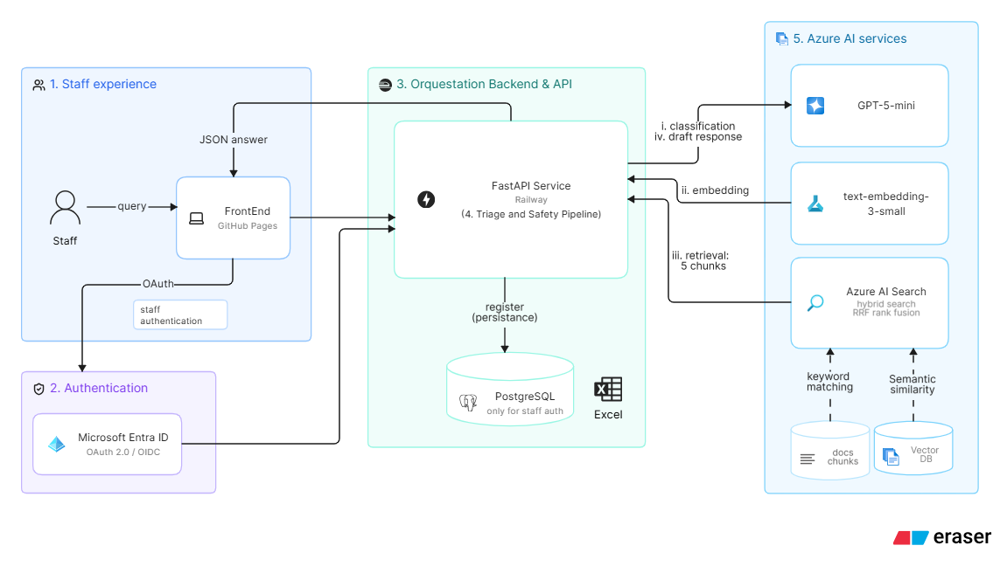
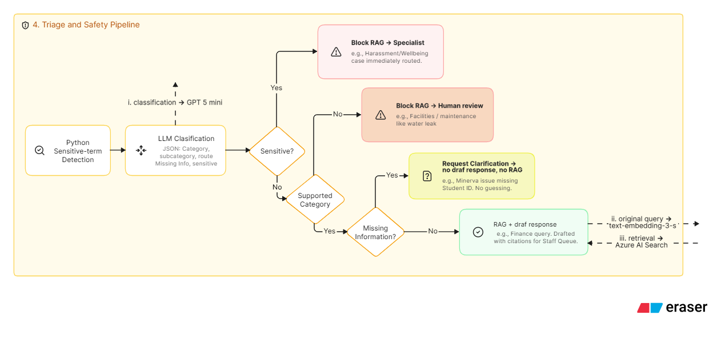

# Agentic Support Intelligence

An Azure-based staff workbench that categorises unstructured university
enquiries, routes sensitive cases without generation, and drafts cited answers
from an approved knowledge corpus. It focuses on deterministic safety controls,
provenance, Entra ID, human review, and measurable quality.

## Key highlights

- **Safety first:** sensitive enquiries never reach the AI. They go straight to specialists.
- **Grounded answers:** drafts cite approved university documents, with no invented facts.
- **Human in the loop:** staff review every draft before it is sent.
- **Enterprise security:** Microsoft Entra ID sign-in, least-privilege access, no secrets in the repo.
- **Measured quality:** retrieval and triage are evaluated against test sets.

## How it works



1. **Staff experience:** a staff member types an enquiry into the web workbench
   (hosted on GitHub Pages).
2. **Authentication:** sign-in goes through Microsoft Entra ID (OAuth 2.0 / OIDC),
   so only authorised university staff can use the tool.
3. **Backend & API:** a FastAPI service on Railway runs the logic, saves every
   case to PostgreSQL and can export cases to Excel.
4. **Triage & safety:** each enquiry is classified before anything is generated
   (see below).
5. **Azure AI services:** GPT-5-mini classifies enquiries and drafts answers.
   Azure AI Search finds the five most relevant passages in approved university
   documents, using both keyword and semantic (embedding) search.

### Triage and safety: deciding when the AI should *not* answer



Every enquiry goes through deterministic checks before the AI writes anything:

| Situation | Example | Outcome |
| --- | --- | --- |
| Sensitive | Harassment or wellbeing concern | No AI answer. Routed straight to a specialist |
| Out of scope | Facilities issue such as a water leak | No AI answer. Sent for human review |
| Missing information | Student-system issue with no student ID | Asks for clarification instead of guessing |
| Supported and complete | Finance or fees question | AI drafts an answer with citations for staff to review |

The AI only drafts an answer when it is safe and the answer can be grounded in
approved sources. A human always reviews the draft before it is sent.

## Status

| State | Capabilities |
| --- | --- |
| Implemented | PDF/HTML pipeline, evaluated RAG, safe triage, FastAPI, PostgreSQL repository, Excel export, portfolio workbench |
| Provisioned | Chat deployment and three Blob containers |
| Deployed | Railway API, PostgreSQL attachment, Entra service principal, GitHub Pages workbench |
| Planned | Persistent rate limiting, production telemetry, authenticated ingestion |

## Start here

Approved PDF and HTML snapshots enter through the ignored `data/sources/`
directory; the application does not download them automatically from URLs.

- [Documentation learning path](./docs/README.md)
- [Project architecture](./docs/overview/project-architecture.md)
- [Retrieval baseline](./docs/stage_05_retrieval/retrieval-evaluation.md)
- [Grounded answers](./docs/stage_05_retrieval/grounded-answer-generation.md)
- [Enquiry triage and safety](./docs/stage_06_triage/enquiry-triage.md)
- [Triage evaluation](./docs/stage_06_triage/triage-evaluation.md)
- [Portfolio UI decision](./docs/overview/ui-options.md)
- [Serving and deployment guide](./docs/stage_07_serving/api-and-portfolio.md)
- [Source ingestion guide](./docs/stage_01_ingestion/source-ingestion.md)
- [Script stages](./scripts/README.md)

## Run locally

```bash
cp .env.example .env          # fill in Azure settings; never commit secrets
pip install -r requirements.txt
python -m unittest discover -s tests -v
```

Local Azure access uses `InteractiveBrowserCredential`. Railway uses an Entra ID
service principal with least-privilege RBAC. Source PDFs, extracted text, chunks
and embeddings stay out of the repository.
